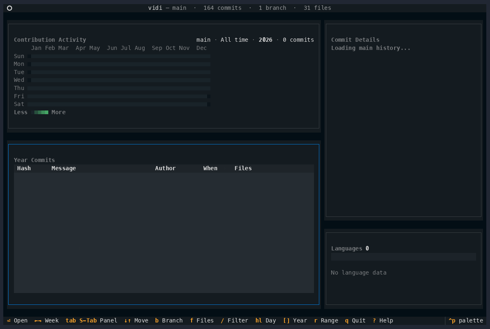

# vidi

<p align="center">
  
</p>

<p align="center">A read-only terminal viewer for a local Git repository.</p>

## Layout

```text
+-----------------------------------+---------------------------+
| Contribution Activity             | Commit Details            |
|  (year heatmap, one cell per day) |  (author, message, files  |
|                                   |   changed for the current |
+-----------------------------------+   commit)                 |
| Year Commits                      |                           |
|  (commit table for the selected   +---------------------------+
|   branch, year and range)         | Languages                 |
|                                   |  (percentage bar and per- |
|                                   |   language breakdown)     |
+-----------------------------------+---------------------------+
```

`Tab` moves between the commit table, details panel, languages panel, and
graph. Selecting a day on the graph or a row in the commit table updates the
details panel. The commit table filter matches on message, author, hash, and
date.

Press `Enter` on a commit to open its diff, then `[` and `]` to step to the
previous or next commit. The languages panel shows the languages in the
highlighted commit's tree. Press `Enter` on a language to list its files at
that commit and `Enter` on a file to read it.

Press `f` from any panel or from the commit detail to browse the whole tree.
Use `[` and `]` in the file list to step between commits. Files changed in
the commit are marked with a dot. The branch picker shows how many commits each
branch is ahead of or behind the default branch (from `origin/HEAD` or `main`/`master`).

## Install

```bash
pipx install vidi    # or uv tool install vidi or pip install vidi
```

> [!IMPORTANT]
> Requires Python 3.9+ and `git` 2.24+ on `PATH`.

## Run

```bash
git view /path/to/repo    # or vidi /path/to/repo
```

Or from anywhere inside a repo:

```bash
git view    # or vidi
```

> [!TIP]
> For shorter commands use `alias gv='git view'`.

## Settings

Apart from the path, everything is set inside the app from the command palette
(`Ctrl+P`). Settings are saved to `~/.config/vidi/config.json` or
`$XDG_CONFIG_HOME/vidi/config.json` when set.

The command palette additionally exposes these settings:

- "Transparent background" uses the terminal's background and keeps the
  theme's borders, selection, and text.
- "Graph: commit table follows on Enter" makes moving over the graph wait for
  `Enter` before it selects a commit. "Graph: commit table follows as you move"
  switches back to the default.
- "Language settings" chooses whether languages are measured by bytes or file
  count, which languages to exclude, and which extra directories the scan skips.
- "Change theme" picks a theme. "Reset theme to default" switches back to the default.
- "Wrap lines in diffs" and "Wrap lines in file view" choose whether long lines
  wrap or scroll sideways. Diffs wrap by default.

## Keys

Press `?` in the app for the same reference.

<details>
<summary>Click to expand</summary>

<!-- keys:start -->

### Main screen

| Key | Action |
| --- | --- |
| `j` / `k` or `up` / `down` | Move within the focused panel |
| `tab` / `shift+tab` | Switch between panels |
| `enter` | Open the commit, or the highlighted language's files |
| `f` | Browse the highlighted commit's files |
| `/` | Filter the commit table (esc clears) |
| `left` / `right` | Previous / next language, or back / forward a week on the graph |
| `h` / `l` | Select the older / newer active day |
| `[` / `]` | Step through years |
| `r` | Cycle the date range |
| `b` | Pick a branch |
| `?` | Show the key reference |
| `q` | Quit |

### Commit detail

| Key | Action |
| --- | --- |
| `j` / `k` or `up` / `down` | Move within the focused pane |
| `tab` / `shift+tab` | Switch between panes |
| `[` / `]` | Previous / next commit |
| `p` | Toggle file diff and full patch |
| `f` | Browse this commit's files |
| `/` | Filter the files list, or search the patch |
| `enter` / `shift+enter` | Next / previous patch match while searching |
| `n` / `N` | Next / previous patch match |
| `left` / `right` | Scroll the patch sideways when lines are not wrapped |
| `page up` / `page down` | Scroll by a page |
| `home` / `end` | Jump to the top or bottom |
| `esc` / `q` | Back (esc first closes the search) |

### Branch picker

| Key | Action |
| --- | --- |
| type | Filter the branch list |
| `up` / `down` | Move the highlight |
| `enter` | Switch to the highlighted branch |
| `esc` / `q` | Cancel |

### Commit files

| Key | Action |
| --- | --- |
| `j` / `k` or `up` / `down` | Move between files |
| `/` | Filter the list (esc clears) |
| `[` / `]` | Previous / next commit |
| `enter` | Open the highlighted file |
| `esc` / `q` | Back |

### File view

| Key | Action |
| --- | --- |
| `j` / `k` or `up` / `down` | Scroll (arrows scroll even while searching) |
| `/` | Search in the file |
| `enter` / `shift+enter` | Next / previous match while searching |
| `n` / `N` | Next / previous match |
| `left` / `right` | Scroll sideways when lines are not wrapped |
| `[` / `]` | Previous / next file |
| `page up` / `page down` | Scroll by a page |
| `home` / `end` | Jump to the top or bottom |
| `esc` / `q` | Back (esc first closes the search) |

<!-- keys:end -->

</details>

## Development

```bash
pip install -e ".[test]"
python -m pytest -q
```

> [!IMPORTANT]
> The man pages in `man/` and the key tables in this README are generated from
> the `vidi -h` parser and the in-app help.  
> **Regenerate with `python -m vidi.docs` after changing either.**  
> A test will fail when they are out of date. Editable installs don't include
> the man pages, which `git view --help` needs.

## License

vidi is free software under the GNU General Public License v3.0 or later. See
[LICENSE](https://github.com/affaan-git/vidi/blob/main/LICENSE) for the full
text.
